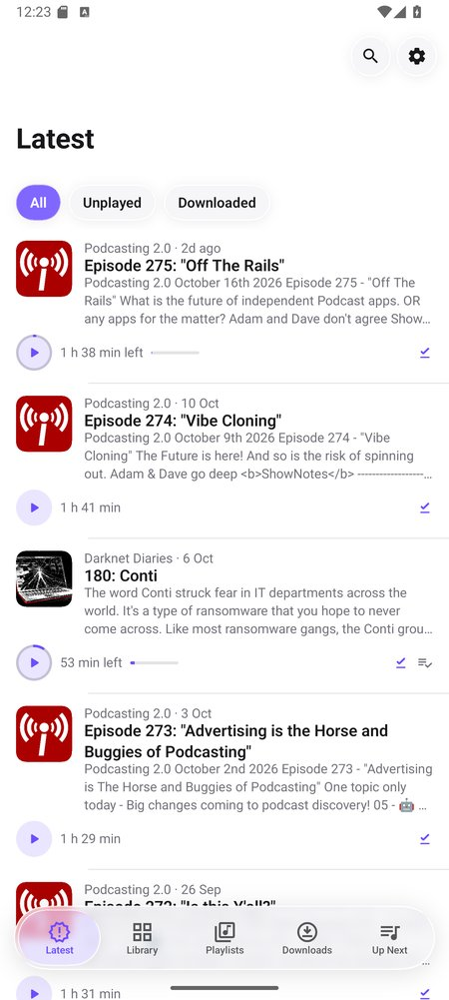
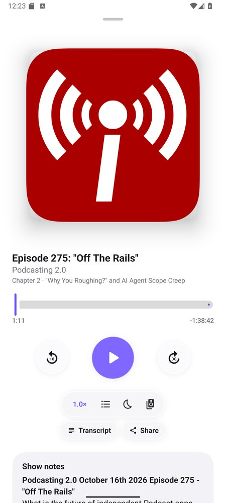
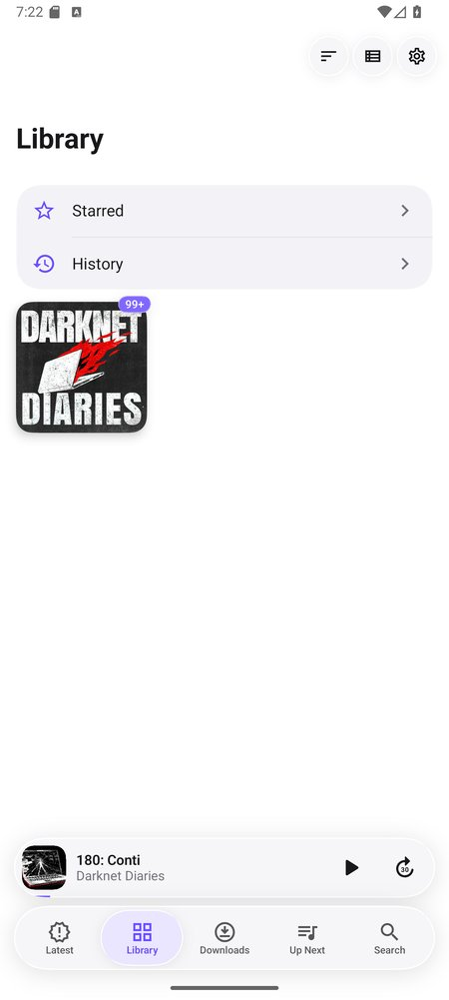
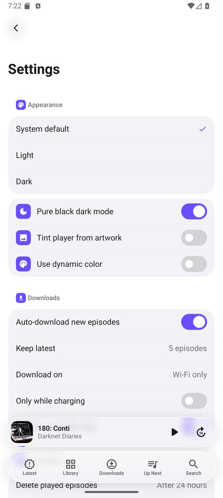

# McPodface

A native Android podcast app with a Liquid Glass (iOS 26 style) interface, smart auto-download and
auto-delete, and an offline episode archive you can search. It is built for personal use and
sideloaded onto a Galaxy S25 Ultra and S23+. The feature set takes cues from Pocket Casts and
Player.fm.

<p>
  
  
  
  
</p>

> **Status:** in active development. Playback, discovery, subscriptions, refresh, downloads and
> settings (global and per podcast), episode search and archive backfill work. The backup screens are
> still to come. See
> [docs/ROADMAP.md](docs/ROADMAP.md).

## Features

**Working now**
- **Discover**: searches Podcast Index and iTunes together, with Listen Notes as a fallback. Also
  trending and categories, add-by-URL (including password-protected feeds) and OPML import/export.
- **Latest**: new episodes from all your subscriptions, with All / Unplayed / Downloaded filters.
- **Library**: subscriptions in a grid or list, with unplayed badges, Starred, and a History of what
  you've played.
- **Playback** through Media3: works from the lock screen, notification, Bluetooth and Galaxy Buds.
  - Per-podcast speed, skip intro/outro, trim silence, voice boost and resume rewind.
  - Sleep timer that fades out, adds 5 minutes when you shake the phone, or stops at the end of
    the episode.
  - Up Next queue with drag-to-reorder, and autoplay of the next episode.
  - Marks an episode played at 95% and saves your position every 10 seconds.
- **Auto-download and auto-delete**, set globally:
  - "keep the latest N episodes";
  - Wi-Fi only, or Wi-Fi and mobile data;
  - delete played episodes after a delay.
  - Downloads resume where they left off and retry on failure.
- **Background refresh** with grouped new-episode notifications.
- **Episode search**, offline, across every episode's title and show notes: phrases, `-exclusions`
  and `OR`, filters (date, status, downloaded, starred, duration), relevance ranking and
  highlighted snippets. Also works within one podcast.
- **Archive backfill**: slowly fetches older episodes a feed no longer lists (RSS paging, then
  Podcast Index), within a daily API budget.
- **Settings** for theme (light / dark / system / pure black), downloads, playback, notifications
  and backup.

**Planned**: full backup and restore between phones, chapters, a widget and Android Auto.

## Design

The UI follows Apple's Liquid Glass language. It uses Kyant's
[backdrop](https://github.com/Kyant0/AndroidLiquidGlass) library for real refraction and blur, and
continuous-corner shapes throughout:
- the tab bar and mini player float above content as glass;
- the full player is tinted with colours taken from the episode artwork.

Where a stock Material control runs more smoothly than a custom one (the timeline scrubber, for
example), the stock control wins. See [docs/ARCHITECTURE.md](docs/ARCHITECTURE.md#liquid-glass).

## Tech

Kotlin · Jetpack Compose + Material 3 · Hilt · Room with FTS4 · DataStore · Media3 (ExoPlayer,
MediaLibraryService) · WorkManager · Retrofit / OkHttp · Coil 3 · Kyant backdrop + shapes.

minSdk 33, target/compile SDK 37. One Gradle module. AGP 9 with built-in Kotlin.

## Building

You need Android Studio (for its JDK and SDK) and free API keys from Podcast Index and,
optionally, Listen Notes. Full steps are in [docs/BUILDING.md](docs/BUILDING.md). In short:

```sh
# put your keys in local.properties (git-ignored), then:
./gradlew :app:installDebug     # debug build
./gradlew :app:installFast      # non-debuggable build over the debug app (judge smoothness)
./gradlew :app:testDebugUnitTest
```

## Documentation

| Doc | What's in it |
|---|---|
| [docs/BUILDING.md](docs/BUILDING.md) | Setup, API keys, signing, build types, tests, emulator |
| [docs/ARCHITECTURE.md](docs/ARCHITECTURE.md) | Package layout, data flow, playback, downloads, glass rules |
| [docs/ROADMAP.md](docs/ROADMAP.md) | What's done and what's next |
| [PLAN.md](PLAN.md) | The full product spec and task breakdown (source of truth) |
| [CLAUDE.md](CLAUDE.md) | Conventions for AI coding agents working in this repo |
| [TESTING.md](TESTING.md) | On-device testing checklist |

## How it's built

The app is built with [Claude Code](https://claude.com/claude-code). An Opus model orchestrates
the work and builds the tricky parts: the playback service, policies and downloads. Haiku subagents
build self-contained screens in parallel, each in its own git worktree, following `PLAN.md` and
`CLAUDE.md`.

## License

[Apache 2.0](LICENSE)
